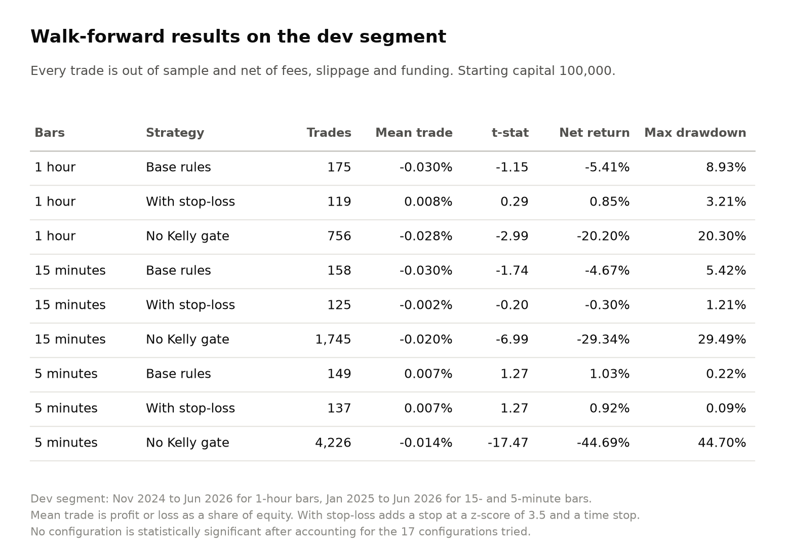
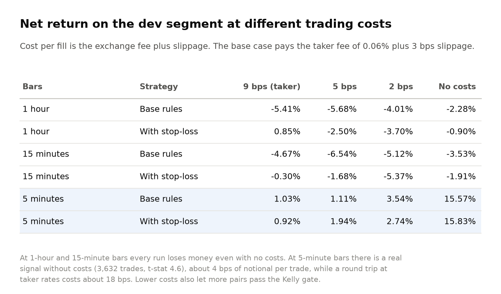
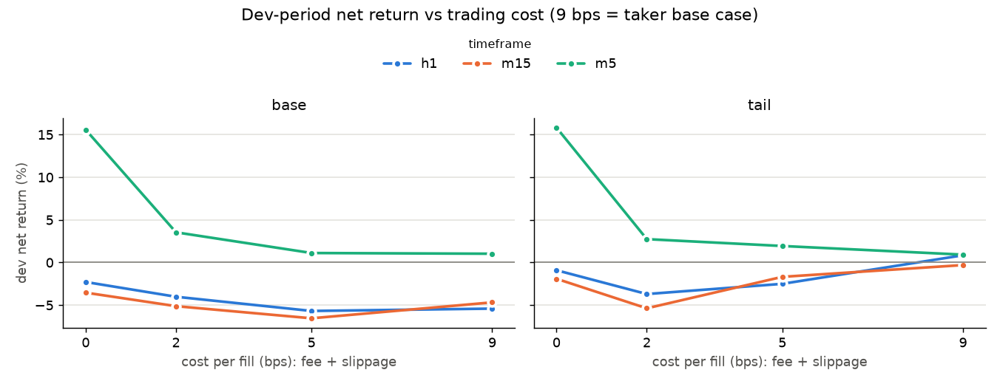
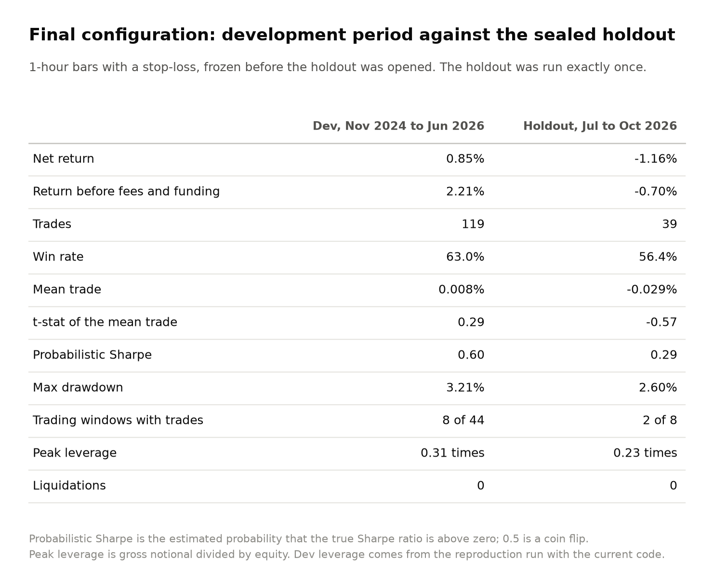
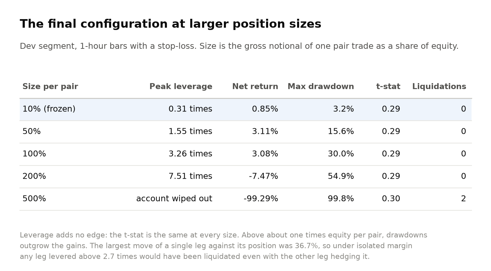

# Kalman-filter pairs trading on crypto perpetual futures

This study tests whether a cointegration pairs-trading strategy makes money on liquid
crypto perpetual futures after costs, with every trade out of sample. It does not. Across
18 configurations on 1-hour, 15-minute and 5-minute bars, none has a statistically
significant edge after costs, and the final configuration lost 1.16% on a holdout period
that was run once.

## Method

The data is 80 USDT-margined perpetuals on KuCoin Futures from August 2024 to October
2026: candles, turnover per bar and funding history. Hourly closes for the 57 coins also
listed on Coinbase match Coinbase's spot prices to a median of 7 basis points, and BTC and
ETH to 1.6.

Each trading period, pairs are chosen using only the preceding formation window, 90 days
for 1-hour bars and 60 days for the others. The 30 most liquid contracts are clustered
after removing the market factor, and every pair within a cluster is tested for
cointegration with Engle-Granger in both directions. A Benjamini-Hochberg correction
controls the false discovery rate across all tests, and the survivors need a
mean-reverting spread with a suitable half-life. A Kalman filter tracks each pair's hedge
ratio, with its noise fitted by maximum likelihood. A pair is traded only if it was
profitable when traded over its own formation window with all costs (the Kelly gate).

Trades open when the spread's z-score passes 2 and close when it returns inside 0.5. Each
trade is 10% of equity, filled at the next bar's open at the 0.06% taker fee plus 3 basis
points of slippage, and each leg pays or receives its actual funding rate.

The walk-forward runs this through the data from November 2024 to June 2026. July to
October 2026 was held out and run once, for the final configuration only. Every run is
logged, and the deflated Sharpe ratio of Bailey and Lopez de Prado (2014) adjusts for the
number of configurations tried. The test suite checks that no decision uses future data,
that profit and loss reconcile, and that the paper trader makes the same decisions as the
backtest.

## Results

The best dev t-statistic is 1.27. If none of the 17 configurations that traded had any
skill, the best would still be expected to reach an annualized Sharpe ratio of about 3.7,
and every deflated Sharpe probability is below 0.0001. Most trades win, but the average
loss is larger than the average win, and without a stop-loss the worst 5% of trades lose
more than the rest make. The largest losses come from real breaks between two coins that
the filter adapts to, so the z-score returns to zero while prices do not. The Kelly gate
helps: without it, losses were 20% to 45%.

At 1-hour and 15-minute bars every run loses money even with no trading costs. At
5-minute bars there is a signal before costs, spread across 229 trading days and 78 pairs,
with a t-statistic of 3.0 measured by day. It is worth about 4 basis points per trade,
while a round trip at taker rates costs about 18. Funding was at most about 5% of fees.

The rule set in advance chose the configuration with the highest dev deflated Sharpe,
which was 5-minute bars without a stop-loss. All of its 149 dev trades fell in 2 of 75
weeks, too few for that statistic to be meaningful. Before the holdout was opened, the
rule was changed to require at least 30 active trading days, which selected 1-hour bars
with a stop-loss. Any minimum from 14 to 61 days gives the same choice. Its dev
t-statistic of 0.29 is consistent with no edge, and the holdout agrees: a loss of 1.16%
over 39 trades with a t-statistic of -0.57.

Liquidation is checked at each bar's close and at the worst point within each bar. At the
frozen size, leverage peaked at 0.31 times equity and the margin ratio never fell below
3.21. Larger positions do not change the t-statistic, and above about one times equity per
pair the drawdowns exceed the gains.

## Other experiments

An adaptive Kalman filter, with time-varying measurement noise and separate drift rates for
the hedge ratio and the level, fitted the data better but did not trade better. A
classifier trained on past trades ranked 15- and 5-minute trades better than chance (AUC
0.60 to 0.68), but the trades it kept still lost money.

## Paper trading

The final configuration has paper traded on live KuCoin prices since 12 October 2026 with
the backtest's code. Its first period found one valid pair, TAO and ENA, which failed the
Kelly gate, so it holds no positions until the next selection on 26 October. The strategy
traded in about one period in five during the backtest.

## Limitations

The coin list is the 80 largest contracts on 11 October 2026, so coins delisted earlier
are missing. Fills are modelled at the next bar's open with fixed slippage and no order
book, and the maintenance margin is a flat 1%. KuCoin does not serve US residents for
trading, so only public market data was used. Profiting from the 5-minute signal would need
costs of about 2 basis points per fill, which means maker orders and a fill model this
study does not have.
